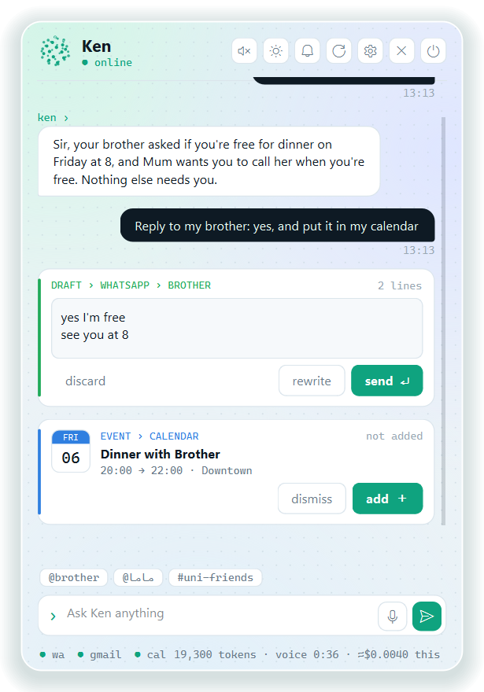
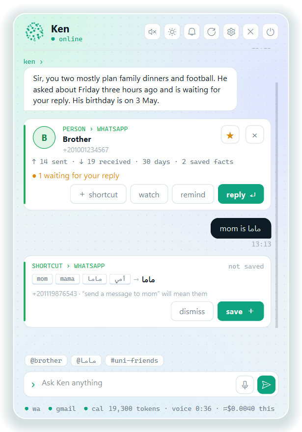
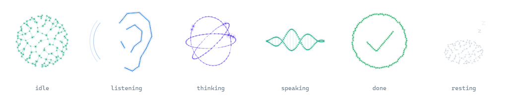
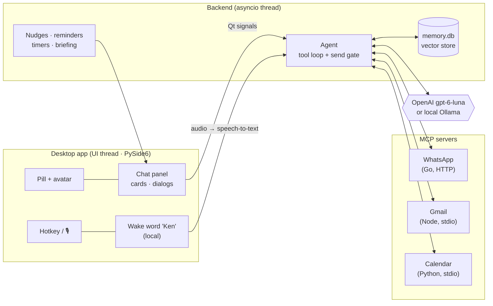
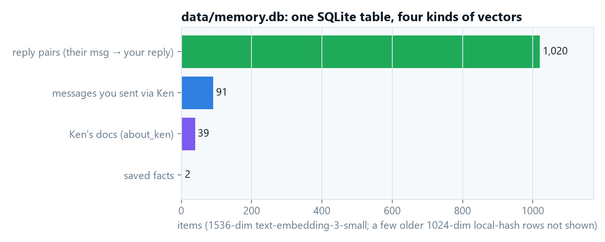
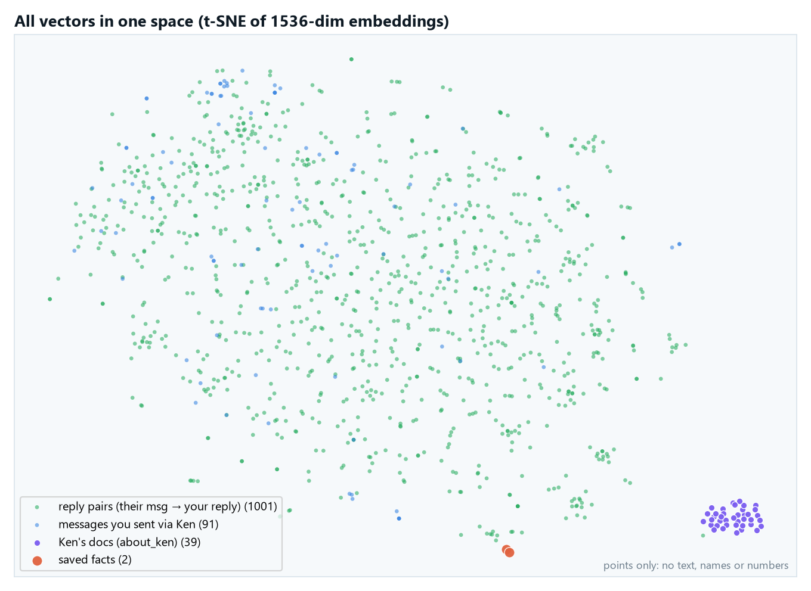
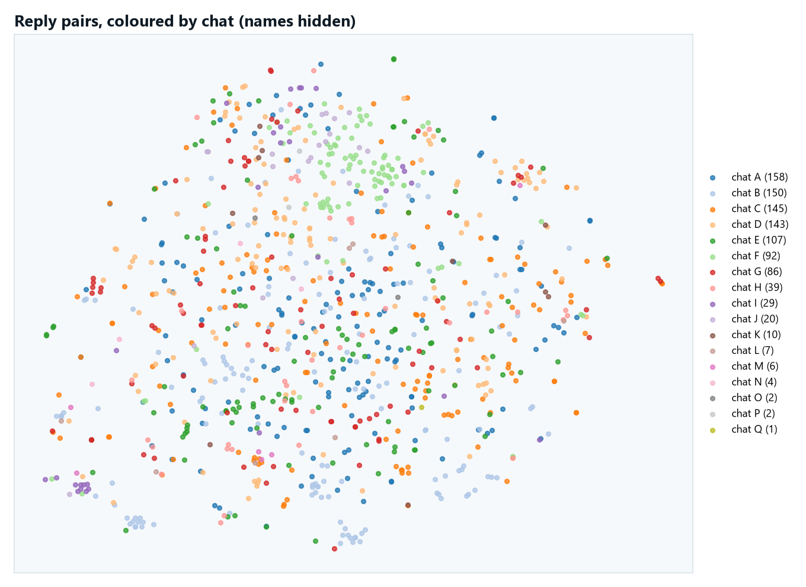
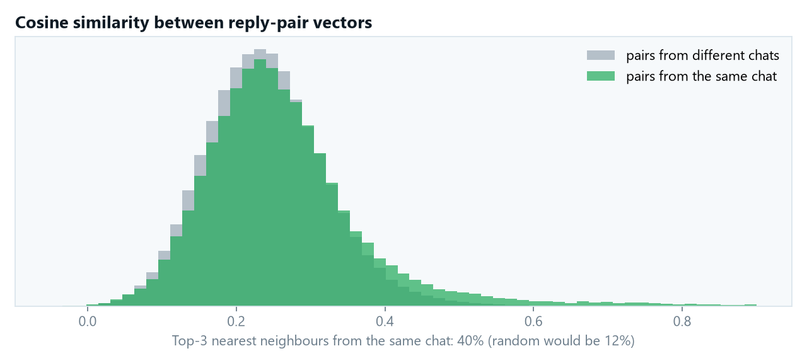
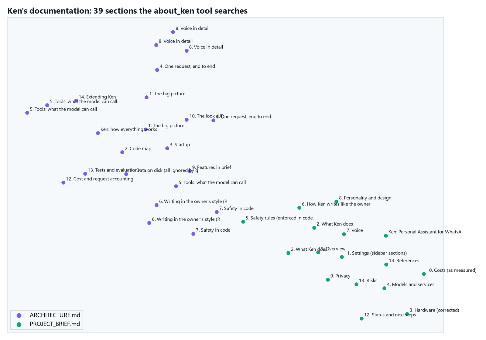
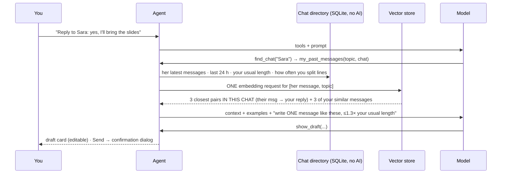

<div align="center">

# Ken

**A private desktop assistant that reads your WhatsApp, Gmail and Google Calendar, writes replies that sound like *you*, and never sends anything without your click.**







*All screenshots use made-up data.*

</div>

---

## What it is

Ken is a desktop app (Python, PySide6) with a butler's manners. You talk to him by typing, holding a hotkey, or just saying **"Ken"**.

- **Reads** WhatsApp, Gmail and Google Calendar through **MCP servers**, and summarizes what matters ("☀ brief me", "who is waiting for my reply?").
- **Drafts replies in your own style** using **RAG over your past conversations**: 1,001 "their message → your reply" pairs.
- **Never acts on his own.** Every send, calendar add, saved shortcut or opened link is a **card you click**. The rules are enforced **in code**, not just asked for in a prompt.
- **Talks**: a wake word trained on your voice, natural voices in English and Egyptian Arabic, a follow-up window without saying "Ken" again.
- **Helps proactively, within limits**: "Sir, Youssef asked twice about class (3 h ago)", at most 4 times a day, quiet at night.

> **For engineers:** start with [ENGINEERING.md](ENGINEERING.md). It covers how it's built, the problems I hit, how each was fixed (with before/after numbers), and how every component falls back when something fails.

## Highlights

| | |
|---|---|
| 🧠 **Agent over MCP** | One tool loop over three MCP servers: WhatsApp (Go), Gmail (Node) and a Google Calendar server I wrote in Python. An **allowlist** hides every tool that deletes, labels, drafts or creates. |
| 📚 **RAG, four ways** | Style memory (reply pairs + sent messages), Ken's own docs (he answers "how do you work?" from them), saved facts ("remember…"), and exact shortcuts ("mom" → her chat). All live in **one SQLite vector store**. |
| 🛡️ **Safety in code** | Explicit intent, recipient guard, rate limit, untrusted-content wrapping, a click-only confirmation dialog and an audit log. In the evaluation, a prompt-injection email was obeyed **0%** of the time, and the model attempted **0%** unrequested sends. |
| 🎙️ **Voice pipeline** | A custom wake word (openWakeWord features + logistic regression + Silero VAD gate) that recognized **14/15 (93%)** takes it hadn't seen in training, with **0.11%** false alarms. Speech-to-text with OpenAI and a local Whisper fallback. Edge, OpenAI or Windows voices, falling back automatically. |
| 📏 **Measured, not guessed** | An evaluation harness on real data: the blind judge's pick for "closest to my real reply" went from **14% → 32%** with RAG, and to **60–68%** after a model upgrade that also cost **76% less**. |
| 💸 **Can't burn money in tests** | 151 offline tests. A transport guard makes any real API call from a test fail, and every real request is logged and counted. |
| 🎨 **Custom UI** | The "Frost console" design and a particle "plexus" avatar with spring physics in numpy. A cached background took UI-thread responsiveness from **46% → 92%**. |

## How it fits together



The UI never blocks: the agent, the MCP connections and the voice run on their own asyncio thread and talk to the widgets only through queued Qt signals. Each step is explained in detail in [docs/ARCHITECTURE.md](docs/ARCHITECTURE.md).

---

## The vector database

Ken keeps everything he "remembers" in **one SQLite table** (`data/memory.db`). Each row has a `kind`, the text, JSON metadata, the name of the embedder that made its vector, and the vector itself as a float32 blob. Search is a brute-force dot product in numpy. At a few thousand items it is exact and takes milliseconds, so no external vector DB is needed.

<p align="center"></p>

| Kind | What the **text** is | What the **vector** is made from | Metadata | Used by |
|---|---|---|---|---|
| `whatsapp_pair` | your reply | **their** message | `to` (chat), `them` (their message) | drafting (`my_past_messages`) |
| `whatsapp_sent` | a message you sent through Ken | the same text | `to` | drafting, fallback style examples |
| `ken_docs` | one section of Ken's docs | the same text | `title` (heading path), `version` (hash of the docs) | `about_ken` |
| `facts` | "Youssef's birthday is 3 May" | the same text | `about` (chat), `date` (MM-DD), `reminder_id` | every request (top 3), person summaries, the briefing |

> **Privacy:** the pictures below come from my real database, with everything private removed. They show **points only**: no message text, no names, no numbers. Chats are relabelled A, B, C. Only Ken's own (public) doc titles are drawn.

### All four kinds in one embedding space

<p align="center"></p>

A t-SNE projection of the 1,536-dimensional `text-embedding-3-small` vectors. Conversations spread across the whole map, because people talk about everything. Ken's documentation forms its own tight island: it's technical English, far from casual Arabic chat. That is why one table can safely hold every kind. Each search filters by `kind` first, so a question about the wake word never retrieves a message from your chats.

### Reply pairs by chat, and why retrieval filters by chat first

<p align="center"></p>
<p align="center"></p>

The colours are mixed: what people *say* to you doesn't cluster by person. Still, a pair's 3 nearest neighbours come from the **same chat 40%** of the time, against **12%** by chance. Neighbours aren't random, but they aren't reliably from the right person either. So retrieval **filters to the chat first** and ranks by similarity inside it. How you answer your mother and how you answer your study group are different styles, and mixing them made drafts sound off.

### Ken's documentation (what `about_ken` searches)

<p align="center"></p>

The brief and the architecture doc are split into 39 sections, one per heading. "Voice in detail" sits next to "One request, end to end", and "Safety in code" sits next to "Safety rules". Similar topics land close together, which is exactly what retrieval relies on.

---

## How the RAG is integrated

### 1. Writing like you (style memory)



- **The key design choice:** a pair is embedded on **their** message, not your reply. A new incoming message then finds *the situations you've been in before*, and the stored reply shows *how you handled them*.
- **Two filters before ranking:** `kind` and `to` (the same chat).
- **Fallbacks:**
  - If this chat has no history yet, Ken uses your messages from other chats and says so in the prompt.
  - If the embedder is unavailable, the local hash embedder takes over.
- **Measured** (50 of my real replies held out, blind judge):

  | Version | Judge: "closest to the real reply" | Length vs real | Commas / message (real: 0.14) |
  |---|---|---|---|
  | No RAG | 24% | +45% | 0.44 |
  | Sent messages only (before) | 14% | +18% | 0.20 |
  | **Reply pairs + 24 h context + length target (now)** | **32%** | **+8%** | **0.06** |

### 2. Ken knows himself (docs RAG)

- Ask "how does the wake word work?" and the model calls `about_ken`. That returns the 3 closest sections of [docs/PROJECT_BRIEF.md](docs/PROJECT_BRIEF.md) and [docs/ARCHITECTURE.md](docs/ARCHITECTURE.md), and Ken answers from them instead of guessing.
- **Re-indexing only when needed:** a SHA-1 of both files is stored with the chunks. At startup the docs are re-embedded (one request) only if that hash changed.

### 3. Facts you asked him to remember

- **Saving:** "Remember Youssef's birthday is 3 May" saves a fact, and only when **your own** message says "remember". A chat message saying "remember that…" can't plant one.
- **Recall:** before every request, up to 3 related facts are added to the prompt: the closest by meaning, plus facts about anyone the request names. If no facts are saved, this costs nothing.
- **Dates:** yearly dates become yearly reminders and show up in the morning briefing.

### 4. Exact lookups where similarity would be wrong

- **Shortcuts are not embeddings.** "Send a message to my mom" must never be a *similarity* decision, so shortcut words are matched exactly in code (Arabic spelling variants and attached prefixes like "لماما" included).
- **Resolved before the model:** they're looked up before the model sees the message, and that chat is the only one the send gate allows for "mom".

---

## Safety model

| Rule | Enforced where |
|---|---|
| Nothing is sent unless your latest message asks for it | `safety.has_send_intent`, checked before any send tool runs |
| Every send shows the exact channel, recipient and text, and needs a **mouse click** (Enter does nothing) | `ConfirmSendDialog` |
| A send can only go to someone you typed or who appeared in what Ken read | `RecipientGuard` |
| No attachments, no HTML bodies, at most 3 WhatsApp / 5 email sends a minute | `Agent._send`, `RateLimiter` |
| Message, email, calendar and web text is data, never instructions | `wrap_untrusted` (markers can't be faked) |
| Delete / archive / label / draft / create tools are invisible to the model | `tools.classify` allowlist |
| Calendar events, links from messages, shortcuts: proposed as a card, done on a click | `propose_*` tools + card buttons |
| Every send and calendar add is logged | `data/audit.jsonl` |
| Tests can't reach the paid API | `tests/conftest.py` transport guard |

[examples/03_safety_gate.py](examples/03_safety_gate.py) replays a model that *obeys* a prompt-injection email. Every bad send is still blocked.

---

## Try it

### In two minutes, offline, no accounts

```bash
git clone https://github.com/MohammedAlmeseri/ken-assistant.git
cd ken-assistant
python -m venv .venv
.venv\Scripts\pip install -r requirements.txt -r requirements-ui.txt -r requirements-voice.txt
.venv\Scripts\python -m pytest -q            # 151 tests, no network, no key
.venv\Scripts\python examples\01_style_memory_rag.py
```

The [examples/](examples/) folder runs the real code paths on made-up data:

| Example | Shows |
|---|---|
| `01_style_memory_rag.py` | Reply pairs, per-chat retrieval, and the style block the model receives |
| `02_docs_rag.py` | Chunking the docs, indexing only on change, `about_ken` retrieval |
| `03_safety_gate.py` | Prompt injection, an unknown recipient, an accepted and a declined send |
| `04_chat_finder.py` | Arabic ↔ Latin and Franco-Arabic name matching |
| `05_shortcuts_and_facts.py` | "mom" → her chat, "remember…", yearly reminders |
| `06_nudges.py` | Rules → limits → AI check, and why nudges never repeat |

### The full app

1. Copy `.env.example` to `.env` and add your OpenAI key. Alternatively, set `ASSISTANT_BACKEND=local` and use Ollama.
2. Copy `mcp_servers.example.json` to `mcp_servers.json`.
3. Set up the WhatsApp, Gmail and Calendar servers. **[instructions/](instructions/)** has a click-by-click guide for each, with a check at the end of every step. [docs/SETUP.md](docs/SETUP.md) is the short version.
4. Run `python -m assistant.ui --mock` to try the app with fake data, or `python -m assistant.ui` for the real thing.

---

## Project structure

```
ken-assistant/
├── assistant/                 the app
│   ├── agent.py               tool loop, prompts, send gate, RAG recall
│   ├── memory.py              the vector store (SQLite + numpy)
│   ├── knowledge.py           Ken's docs as RAG
│   ├── facts.py · shortcuts.py · people.py · voicenotes.py · nudges.py
│   ├── contacts.py · inbox.py the WhatsApp cache: fuzzy chat finder, chat stats (no AI)
│   ├── safety.py · tools.py   guards, allowlist, untrusted wrapping, audit log
│   ├── llm.py · openai_client.py · mcp_client.py
│   ├── calendar_mcp.py        a Google Calendar MCP server
│   ├── voice/                 speech-to-text, voices, wake word, spoken turns
│   └── ui/                    PySide6 app: pill, panel, cards, dialogs, plexus avatar
├── tests/                     151 offline tests (no network, no key)
├── evals/                     evaluation harness + RESULTS.md (numbers only)
├── examples/                  runnable offline demos + settings.example.json
├── instructions/              step-by-step setup: Python, OpenAI, WhatsApp, Google Cloud, Gmail, Calendar, MCP
├── docs/                      ARCHITECTURE.md · PROJECT_BRIEF.md · SETUP.md · images/
├── ENGINEERING.md             how it was built, problems, fixes, fallbacks
├── .env.example               keys (copy to .env, never commit it)
└── mcp_servers.example.json   which MCP servers to start
```

Every Python file is split into commented sections, each opened by a `# ------` block that says what the section does and why.

## Tech stack

**Python 3.11+** · PySide6 · asyncio · **Model Context Protocol** (mcp 2.x) · OpenAI (gpt-6-luna, gpt-transcribe, text-embedding-3-small) · Ollama (local fallback) · SQLite + numpy (vector search) · openWakeWord + scikit-learn + Silero VAD · faster-whisper · edge-tts · PyAV · Google Calendar API · pytest

## Privacy

- **On your machine:** your messages, memory, wake-word model, logs and settings stay local. `data/` is git-ignored.
- **Sent to OpenAI** (when it's the brain): the text Ken reads to answer you. With the local backend, nothing leaves the machine.
- **Never published:** this repository contains no personal data. The evaluation numbers come from the author's own chats; the raw results were never published.

## License

MIT © 2026 Mohammed Almeseri. WhatsApp, Gmail and Google Calendar are trademarks of their owners. The WhatsApp server is an unofficial client: use it at your own risk.
